<!--
SPDX-FileCopyrightText: 2023 Linnea Gräf <nea@nea.moe>
SPDX-FileCopyrightText: 2026 Ashton (Ashtonite365)

SPDX-License-Identifier: CC0-1.0
-->

# SkyBlock Apex
An all-in-one Hypixel SkyBlock mod for Minecraft 26.3 Fabric, with custom menus, a custom far-terrain renderer and a big set of quality-of-life modules.

**Inspired by Firmament and NEU**, with additions from all your favorite SkyBlock mods, all in one.

## Highlights
- **295 modules** across Look & Feel, Timers, GUI, HUD, Waypoints, Dungeons, Secrets, Mining, Farming, Fishing, Custom Menus, Experimentation and Miscellaneous
- **Custom menus** for the SkyBlock Menu, Auction House, Bazaar, Storage, Skills and many more, in Skyglass and Forge (light/dark) styles
- **Custom far-terrain renderer**, so you don't need Distant Horizons
- **In-game wiki viewer**: hover an item in any SkyBlock inventory and hold the wiki key (default **J**, about 1.5 s, configurable) to open its page from the official Hypixel SkyBlock Wiki in an in-game screen
- **Built-in textures** like Low Fire and other popular ones
- Works best with **JEI** and **Sodium**

## Still a little unstable
You might find a crash in some obscure place. Please report it in [Issues](https://github.com/Ashtonite365/SkyBlock-Apex/issues), and give the repo a star if you enjoy the mod.

## Screenshots

**Settings menu (Look & Feel)**

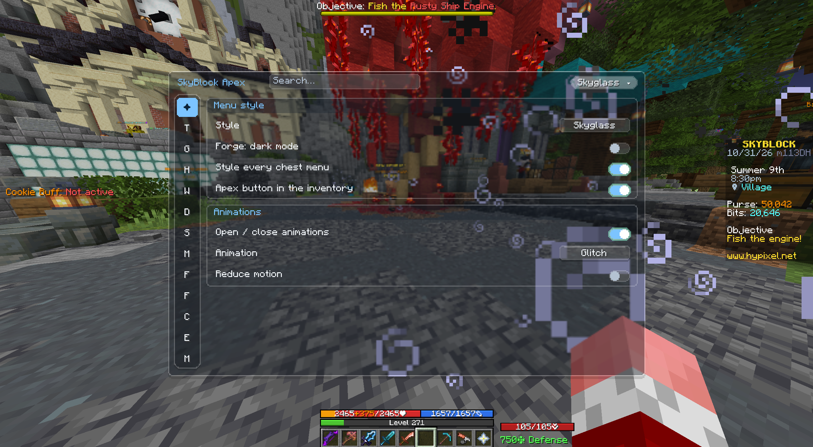

**Settings category list**

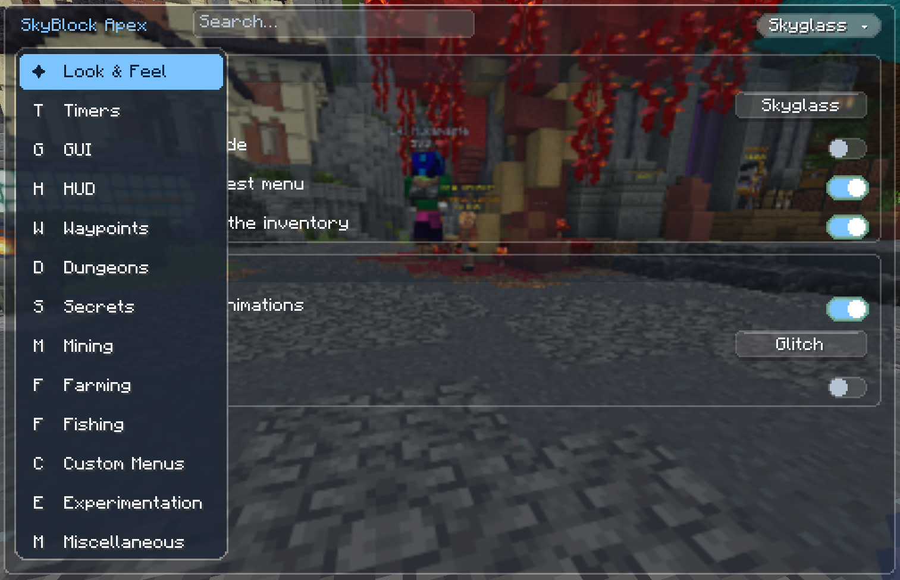

**Forge-style Auction House**

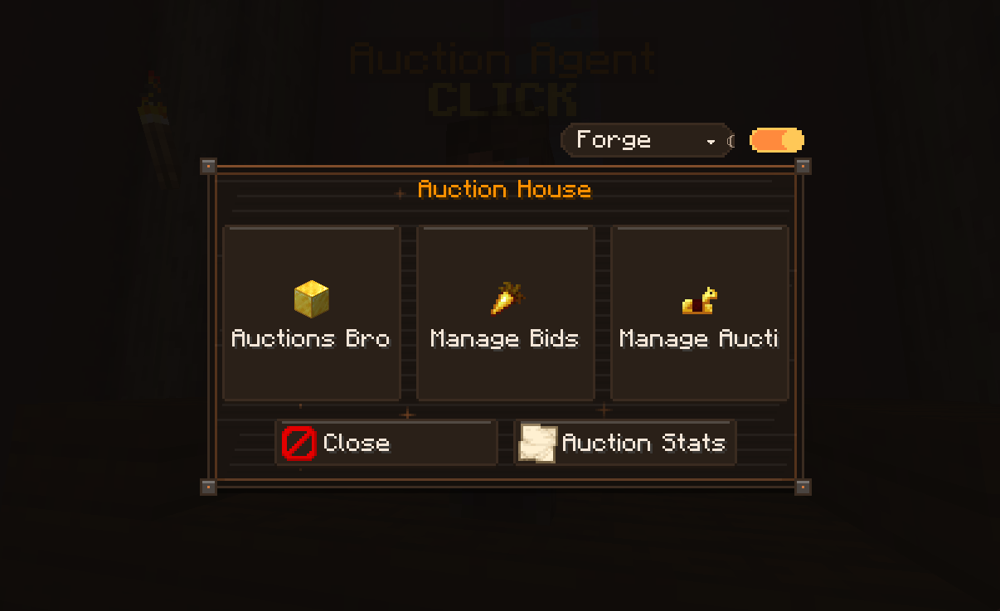

**Skyglass SkyBlock Menu with the JEI panel**

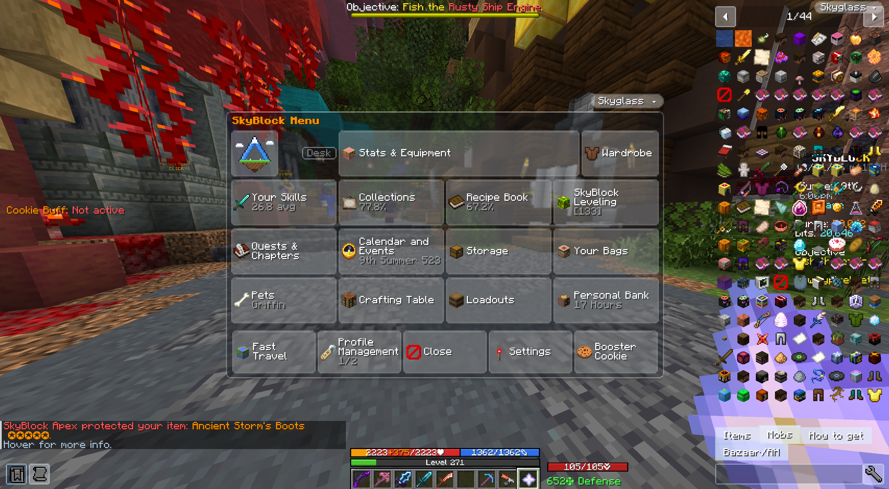

**Inventory with potion-effect HUD**

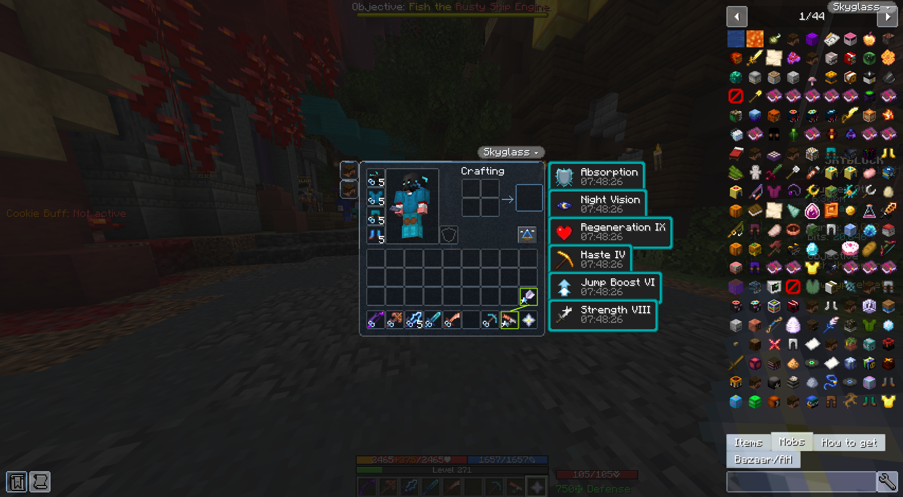

**JEI SkyBlock mob view**

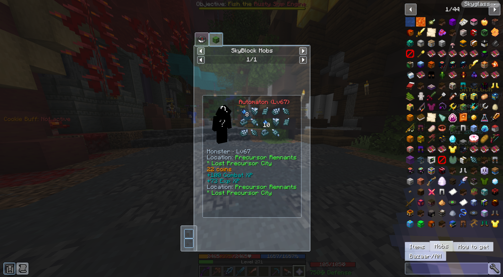

**Style dropdown (Vanilla JEI / Skyglass / Forge)**

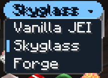

**Forge dark SkyBlock Menu**

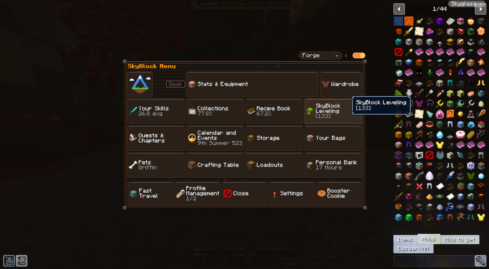

**Forge light SkyBlock Menu**

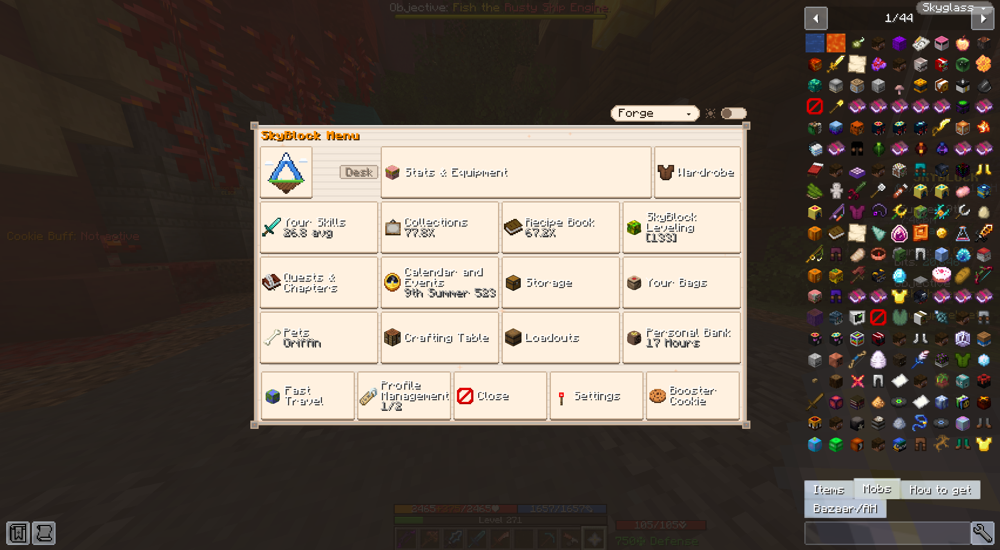

**Bazaar custom menu**

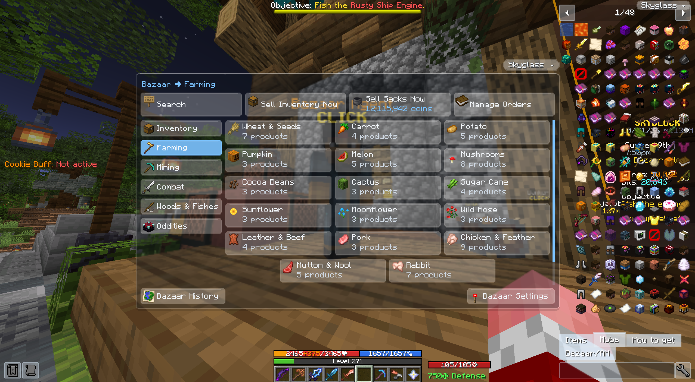

**Storage overview (ender chests and backpacks)**

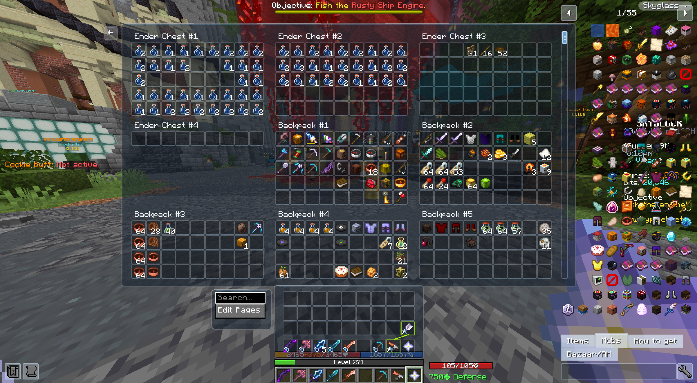

## Install
1. Install [Fabric Loader](https://fabricmc.net/use/) for Minecraft 26.3.
2. Put [Fabric API](https://modrinth.com/mod/fabric-api) and [Fabric Language Kotlin](https://modrinth.com/mod/fabric-language-kotlin) in your `mods` folder (both are required).
3. Download the SkyBlock Apex jar from [Releases](https://github.com/Ashtonite365/SkyBlock-Apex/releases) and drop it into `mods`.
4. Optional but recommended: [JEI](https://modrinth.com/mod/jei) and [Sodium](https://modrinth.com/mod/sodium).

All commands live under `/apex` (`/apex help`); settings are at `/apex options`.

## Building

The Hypixel SkyBlock Resource Pack is not bundled in the jar. At runtime SkyBlock Apex downloads it from Hypixel's
official API (`https://api.hypixel.net/v2/resources/packs`), checks it against Hypixel's SHA-1 and caches it in
`config/apex/cache/`. If a later download fails or does not match, the last good cached copy is used (logged only);
with no cached copy at all, one toast per session says so and the game carries on without it (`/apex hypixelpack`
retries). The pack is (C) Hypixel Inc., under its own licence, downloaded from Hypixel, not distributed by Apex.

Build steps (Java 25):

```sh
./gradlew test                # unit tests
./gradlew build               # jar -> build/libs
./gradlew jarContentsTest     # checks the built jar's contents (no Hypixel pack, licence files present)
```

## License
SkyBlock Apex is licensed **GPL-3.0-or-later** (full text in [LICENSE](./LICENSE)). It is a modified version of
[Firmament](https://github.com/FirmamentMC/Firmament) by Linnea Gräf (nea89o) and the Firmament contributors, also
GPL-3.0-or-later, modified by Ashton (Ashtonite365), 2026. See [NOTICE](./NOTICE), [LICENSES/](./LICENSES),
[third-party-licenses/](./third-party-licenses) and `REUSE.toml` for per-file licences.

### Licensing and contribution policy

Most of this mod is licensed under a GPL-3.0-or-later license. Some resources may also be licensed using creative
commons licenses. You can use the reuse spec to check the concrete licenses for
each file. See the licenses folder for the concrete license terms of each license.

Whenever you add Content to this repository, you license that Content under those terms as specified by reuse, and you
agree that you have the right to license that Content under those terms. If you want your Content to be available under
a different license, or with explicit credit to you, make sure to request so in your pull request, or to provide an
appropriate reuse `.license` file. (Note that an incompatible deviating license might result in your contribution being
rejected.)

Contributions are tentatively welcomed. The structure of the mod is probably not really transparent to newcomers, but if
you are interested, feel free to tackle any issues or create your own
features.

## Credits
- **Firmament** by Linnea Gräf and contributors: the mod SkyBlock Apex is based on.
- **NotEnoughUpdates (NEU)**: inspiration and the NEU item repository.
- Everyone else listed in [CREDITS.md](./CREDITS.md) and in-game at `/apex credits`.

### Affiliation

SkyBlock Apex is an unofficial, free fan-made mod based on Firmament (GPL-3.0-or-later; see CREDITS.md and NOTICE).
It is not an official Minecraft product and is not approved by or associated with Mojang Studios or Microsoft, and it
is not affiliated with, endorsed by or sponsored by Hypixel Inc.
